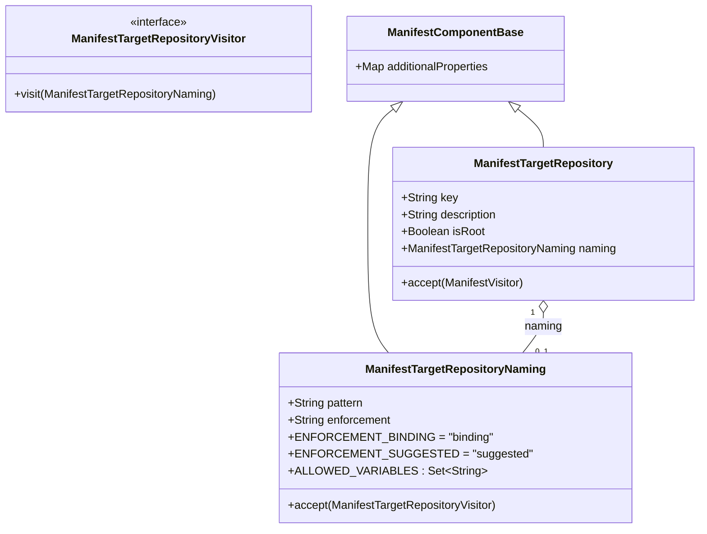

# Repository naming conventions in the Blueprint manifest (`targetRepositories[].naming`)

## Requirements

Let a platform engineer declare, in the Blueprint manifest, the naming convention that the physical Git repository bound to each `targetRepositories[]` key must follow when a data product is instantiated.

The blueprint server owns the **specification** and its **publish-time validation** only. Enforcement (deriving names, locking them, restricting selection) happens in the Blindata UI instantiation wizards, guided by the manifest content. The server does **not** check repository names at instantiate or update.

Source analysis: `spdd/analysis/BDMD-5427-202610271754-[Analysis]-blueprint-repository-naming-conventions.md`. Companion prompts: `blindata-ui/spdd/prompt/BDMD-5427-202610301530-[Feat]-ui-blueprint-repository-naming-conventions.md` and `blindata-site-docs/spdd/prompt/BDMD-5427-202610301530-[Feat]-docs-blueprint-repository-naming-conventions.md`.

## Entities



Manifest shape (YAML):

```yaml
targetRepositories:
  - key: main-repository
    isRoot: true
    naming:
      pattern: "${dpDomain}-${dpName}"
      enforcement: binding   # or: suggested; defaults to binding when omitted
```

- `naming` (Object, Optional).
- `naming.pattern` (String, Required when `naming` is present): literal text plus `${key}` placeholders.
- `naming.enforcement` (String, Optional — defaults to `binding`): `binding` or `suggested`. Kept as a `String` (not a Java enum) so an unknown value parses and is reported by the validator instead of failing deserialization.
- Allowed variables (`ALLOWED_VARIABLES`): `dpDomain`, `dpName`, `dpFqn`, `dpDisplayName`, `dpDescription`, `dpOwnerId`, `dpOwnerName` — the reserved data product parameters the UI auto-fills.

## Approach

1. Specification:
   - Additive, optional field on `targetRepositories[]`. Keep `specVersion: 1.0.0`.
   - Restricted grammar, identical in Java (validates) and JavaScript (resolves): literal text plus `${key}` placeholders. Every `$` must start a `${…}` placeholder; `${` must be closed by `}`; the key is non-empty and contains no whitespace. No Velocity directives, methods, filters or escapes.
   - Document field, grammar, allowed variables, modes, validation rules and shared resolution examples (test vectors) in the manifest README.

2. Model:
   - Add `ManifestTargetRepositoryNaming` under `manifest.model.instantiation`, extending `ManifestComponentBase` (unknown keys preserved), with `accept(ManifestTargetRepositoryVisitor)`.
   - Add `naming` to `ManifestTargetRepository`.
   - Add `ManifestTargetRepositoryVisitor` under `manifest.visitors`, same pattern as `ManifestParameterVisitor` / `ManifestInstantiationEntryVisitor`.
   - `ManifestExtensionVisitorImpl` implements it and walks `targetRepository.getNaming()` so extensions on the nested node are handled.

3. Publish-time validation (manifest validation visitor — runs at publish and when the manifest is re-validated before instantiate; it checks the declaration, never repository names):
   - `naming.pattern` non-blank.
   - Pattern syntax per the grammar.
   - At least one placeholder.
   - Every placeholder key is in `ALLOWED_VARIABLES` **and** declared in `parameters[].key`.
   - `naming.enforcement`, when present, is `binding` or `suggested`.
   - No two `targetRepositories[]` entries with textually identical `naming.pattern` (post-pass global check).
   - All issues are collected with a field path and how-to-fix hint, like existing rules.

4. Module ownership (`PublishBlueprintVersion`):
   - A catalog `MODULE` version whose manifest declares `naming` on any `targetRepositories[]` entry is rejected, next to the existing protected-resources rule, via a new manifest outbound port query `hasRepositoryNamingConventions(JsonNode)`.

5. Unchanged: instantiate and update use cases (no conformance or distinctness check), update structure freeze (still reads only `key` / `isRoot`), Git rendering, lineage snapshot (keeps the convention as authored), `BlueprintGitNamingConventions` (checkpoint tags/branches — do not touch or reuse).

6. README fix: *Instantiation Workflow* step 5 must say the root repository receives a copy of the manifest as published (not rendered), and that resolved parameter values are recorded in the data product descriptor's blueprint metadata.

## Structure

### Inheritance Relationships

1. `ManifestTargetRepositoryNaming` extends `ManifestComponentBase`.
2. `ManifestExtensionVisitorImpl` and `OdmBlueprintValidationVisitor` additionally implement `ManifestTargetRepositoryVisitor`.

### Dependencies

1. `OdmBlueprintValidationVisitor.visit(ManifestTargetRepository)` calls `repository.getNaming().accept(this)` when present; field paths come from `state.currentTargetRepositoryFieldPath`.
2. Placeholder declaration checks use `OdmBlueprintManifestValidatorContext.containsParameterKey` (parameters are visited before `targetRepositories`).
3. `PublishBlueprintVersion.validateModulePublishTopology` uses `PublishBlueprintVersionManifestOutboundPort.hasRepositoryNamingConventions`.

### Layered Architecture

1. Manifest package: model, visitor interface, extension visitor.
2. Use-case layer: structural validation (validator visitor) and module ownership policy (publish use case).
3. No controller, persistence or migration changes.

## Operations

### Create model - `ManifestTargetRepositoryNaming`

1. Package `org.opendatamesh.platform.pp.blueprint.manifest.model.instantiation`.
2. Fields `pattern`, `enforcement` (String) with getters/setters; `accept(ManifestTargetRepositoryVisitor)`.
3. Constants `ENFORCEMENT_BINDING`, `ENFORCEMENT_SUGGESTED`, `ALLOWED_VARIABLES` (unmodifiable, insertion-ordered set of the seven reserved keys).

### Create visitor - `ManifestTargetRepositoryVisitor`

1. Package `org.opendatamesh.platform.pp.blueprint.manifest.visitors`; Javadoc "Visitor for nested nodes under `targetRepositories[]`".
2. Method `void visit(ManifestTargetRepositoryNaming naming)`.

### Update model - `ManifestTargetRepository`

1. Add `naming` field + getter/setter. Jackson maps it by name.

### Update parser - `ManifestExtensionVisitorImpl`

1. Implement `ManifestTargetRepositoryVisitor`; in `visit(ManifestTargetRepository)` walk `naming`; `visit(ManifestTargetRepositoryNaming)` delegates to `extensionHandler.handleComponentBaseExtension`.

### Update validator - `OdmBlueprintValidationVisitor` + `OdmBlueprintManifestValidatorState`

1. Implement `ManifestTargetRepositoryVisitor`.
2. `visit(ManifestTargetRepository)`: after the key check, visit `naming` when present.
3. `visit(ManifestTargetRepositoryNaming)`: validate the local rules from Approach §3 using the field path `<targetRepositories[i]>.naming.pattern` / `.naming.enforcement`. Record `(fieldPath, pattern)` on state for the global check.
4. Post-pass `validateDuplicateNamingPatterns()`: report every entry whose pattern equals an earlier one.
5. Messages and hints (problem fragments must stay stable for tests):
   - blank: "Repository naming pattern is required" — hint "Set naming.pattern, or remove naming."
   - syntax: "Repository naming pattern has invalid placeholder syntax at position N" — hint "Use ${key} placeholders; every $ must start a ${key} placeholder."
   - no placeholder: "Repository naming pattern must reference at least one variable" — hint "Add a placeholder such as ${dpName}; a constant name collides from the second data product on."
   - not allowed: "Repository naming variable 'X' is not supported" — hint "Use one of: dpDomain, dpName, …"
   - undeclared: "Repository naming variable 'X' is not declared in parameters" — hint "Declare X in parameters[]."
   - enforcement: "Repository naming enforcement must be 'binding' or 'suggested'" — hint "Use binding (default) or suggested."
   - duplicate: "Repository naming pattern duplicates targetRepositories[j]" — hint "Give each repository key a distinct naming pattern."
6. Reset the new state collection in `resetState`.

### Update port - `PublishBlueprintVersionManifestOutboundPort` (+ impl)

1. Add `boolean hasRepositoryNamingConventions(JsonNode content)`: true when any `targetRepositories[]` entry has non-null `naming`. Same parse/exception handling as `hasProtectedResources`.

### Update use case - `PublishBlueprintVersion`

1. In `validateModulePublishTopology`, after the protected-resources rule: if the module declares naming → `BadRequestException("A Blueprint module must not declare repository naming conventions. Hint: Remove targetRepositories[].naming from the module; declare naming conventions on the parent Blueprint.")`.

### Update spec - manifest `README.md`

1. Core Schema Objects: add `naming`, `naming.pattern`, `naming.enforcement`; align `description` with its actual use (default description of a created repository and guidance in the UI).
2. New subsection *Repository naming (`targetRepositories[].naming`)*: grammar, allowed variables, modes, wizard-only enforcement, resolution and case-sensitive conformance, shared test vectors:
   - `${dpDomain}-${dpName}` with `sales`/`orders` → `sales-orders`
   - `dp-${dpName}-infra` with `Orders` → `dp-Orders-infra`
   - `${dpDomain}-${dpName}` with empty `dpDomain` → unresolved (`dpDomain`)
   - resolved `sales-orders` vs repository `Sales-Orders` → not conforming
3. Validation constraints: add the naming rules and the `MODULE` rule.
4. Fix *Instantiation Workflow* step 5 (Approach §6).

### High-level tests (Gherkin)

Feature: Repository naming conventions in the manifest
  Scenario: A Blueprint with valid naming conventions is published and keeps them
    Given a polyrepo manifest declaring the reserved parameters dpDomain and dpName
    And targetRepositories entries with naming patterns "${dpDomain}-${dpName}" (enforcement omitted) and "${dpName}-infra" (enforcement suggested)
    When the version is published
    Then the response status is 201
    And the stored content keeps both naming objects as authored

  Scenario: Invalid naming conventions are rejected at publish with every problem and a hint
    Given a manifest with a naming pattern using an undeclared reserved variable, a pattern with a bare $, a pattern without placeholders, a non-reserved variable, an invalid enforcement and a duplicated pattern
    When the version is published
    Then the response status is 400
    And the message lists each problem with its field path and hint

  Scenario: A Blueprint module cannot declare naming conventions
    Given a catalog MODULE manifest whose target repository declares naming
    When the version is published
    Then the response status is 400
    And the message tells the author to declare naming conventions on the parent Blueprint

  Scenario: Naming survives parse and serialize, including unknown keys
    Given a manifest whose naming object has an extra unknown key
    When it is deserialized and serialized
    Then pattern, enforcement and the unknown key are preserved

| Feature / Scenario | Test class | Method |
|---|---|---|
| Valid naming is published and kept | `BlueprintVersionsUseCaseControllerIT` | `whenPublishWithValidRepositoryNamingThenSucceedAndKeepNaming` |
| Invalid naming is rejected with hints | `BlueprintVersionsUseCaseControllerIT` | `whenPublishInvalidRepositoryNamingThenReturn400WithHints` |
| Module cannot declare naming | `BlueprintVersionsUseCaseControllerIT` | `whenPublishModuleWithRepositoryNamingThenReturn400` |
| Naming round-trip | `ManifestTargetRepositoryNamingParserTest` | `whenParseAndSerializeNamingThenPreserveFieldsAndUnknownKeys` |

Each new test method's comment copies its Scenario verbatim (existing project style).

## Norms

1. Use-case layout: `spdd/norms/USE_CASE_IMPLEMENTATION.md` — the module rule stays in `PublishBlueprintVersion`; manifest parsing stays in the outbound port impl.
2. Code structure: `spdd/norms/CODE_STRUCTURE.md` — composed methods; pattern scanning lives as private steps at the bottom of `OdmBlueprintValidationVisitor`; no `*Utils` / `*Helper` types.
3. Manifest package: new nodes extend `ManifestComponentBase` and participate in accept/visit consistently (navigate via `accept`, validate locally in `visit`, global checks in the post-pass).
4. Exceptions: existing `BadRequestException`; collected validator errors keep the problem + hint format.

## Safeguards

1. Functional Constraints:
   - No conformance or distinctness check on instantiate or update; no repository creation on the server.
   - Missing `naming` keeps today's behaviour everywhere.
2. Business Rule Constraints:
   - Variables limited to the seven reserved keys and only when declared in `parameters[]`.
   - At least one placeholder; no textually identical patterns across keys; enforcement `binding` | `suggested`, default `binding` (the server stores the omitted value as omitted — the default is applied by clients).
   - `MODULE` manifests must not declare `naming`.
3. Integration Constraints: no REST, registry, git-utils or DPDS changes. Update freeze unaffected.
4. Technical Constraints: do not extend or rename `BlueprintGitNamingConventions`; do not add a Java enum for enforcement; no new Spring beans.
5. Spec Constraints: `specVersion` stays `1.0.0`; README is the single source of the grammar, variables and test vectors shared with the UI.
